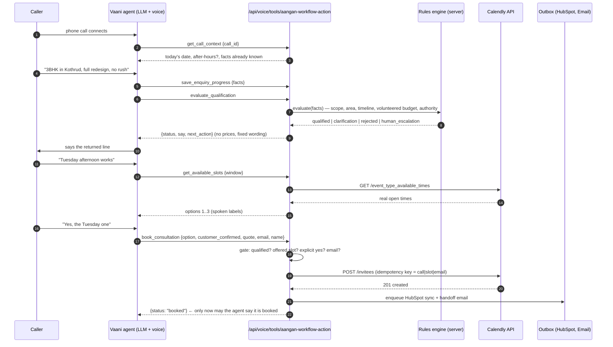

# Architecture

One workflow, four downstream outputs, phone channel only. This follows the *Aangan Studio – Components Map*
(**Trigger → Input → Context → Processing → AI → Output**).

```
 TRIGGER            INPUT                     CONTEXT                    PROCESSING + AI                         OUTPUT (exactly four)
 ─────────          ──────────────────────    ─────────────────────      ─────────────────────────────────       ───────────────────────────
 Incoming call  ──▶ Vaani voice agent    ──▶  content/knowledge/*   ──▶  Qualification engine (deterministic) ─▶ 1. HubSpot (contact + note)
 to Aangan's        answers, converses,       services.md                Workflow orchestrator (state machine)    2. Email notification
 number             captures facts            qualified.md               Gemini: post-call extraction, summary,   3. Calendly booking
                    ▲        │                pricing.md (policy only)   compliance audit (never decides)         4. Management dashboard
                    │        ▼                Transcript fixtures        Human exceptions (escalation queue)
              live tool calls (HTTPS) ◀─────────────────────────────────────────────────────────────────────────
```

* The **trigger** is the incoming call event, not the agent. Vaani's call webhooks (`call_started`, `user_picked_up_at`, `call_ended`, `call_postprocessing`) create and advance the call record.
* The **voice agent is part of Input.** During the call it invokes our server over HTTPS (custom tools) for every fact it saves, every qualification decision, every availability lookup, every booking and every escalation.
* **Context** is read from `content/knowledge/` by `src/lib/knowledge.ts`. `pricing.md` is *never* loaded into a prompt or API response – only the approved deflection sentence is extracted from it.
* **Processing** is deterministic code (`src/lib/domain/*`, `src/lib/services/*`). **AI** (Gemini) only turns a transcript into structured facts and a summary after the call; it cannot change a decision.
* **Outputs** are four, and only four: HubSpot, email notification, Calendly booking, dashboard. Each is written through an outbox job so a failure in one never blocks the others.

## Live tool flow (the mandatory real-time backend call)



Every response is HTTP 200 with `{ok, status, say, next_action, instruction, data}` for business outcomes (so the agent can speak a graceful fallback), 4xx for authentication / schema / rate-limit problems, and 5xx only for genuine crashes (which also raise a human escalation).

## Qualification (qualified.md + rubric.txt)

`src/lib/domain/qualification.ts` is pure, deterministic and unit-tested. Inputs are validated *facts*; outputs are a criterion-level result with evidence:

| # | Criterion (weight – proposed) | Pass | Fail | Unknown |
|---|---|---|---|---|
| 1 | Real project, design **and** execution (30) | wants design + execution; in-scope space | advice/styling only, DIY execution, furniture-only, Vastu-only, restaurant/hotel/retail/gym, commercial < min | one question: *"Are you looking for full design and execution, or design advice only?"* |
| 2 | Service area (25) | Pune city / PCMC (named localities clean; other Pune-city localities with a note) | Nashik, Talegaon, Lonavala, Mumbai, other cities | *"Which locality is the property in?"* |
| 3 | Realistic timeline (20) | completion ≥ 6 weeks away (tight < 10 weeks is noted) | < 6 weeks, or < 6 weeks between site availability and completion | *"When would you need the project completed, and when will the site be available?"* |
| 4 | Broad budget fit – **volunteered only** (15) | volunteered figure not clearly inadequate | volunteered figure clearly below the scope | not mentioned → `unknown_neutral`, **no deduction**, never asked |
| 5 | Decision-maker / authorised (10) | decision-maker or authorised representative | researching for someone else and nobody attends | unclear → `unknown_neutral`, **no deduction**, not pressed |

Dispositions: `qualified`, `clarification_required`, `rejected`, `human_escalation`. Rules of precedence: escalation signals (existing-customer complaint, senior requested, frustrated returning lead) → confirmed failures (policy below) → items needing human judgement → one clarifying question → qualified. **The score never overrides a failed criterion.**

Rejection policy (configurable in *Settings*, default shown): one hard exclusion → polite decline; one softer failure → human review; two or more → polite decline; master switch for automatic declines. This is the documented `qualified.md` ambiguity (see README → *Open business decisions*).

## Call workflow state machine

`call_received → agent_active → capturing_information → checking_qualification → {qualified | clarification_required | rejected | human_escalation}`
then, for qualified: `asking_availability → checking_calendar → awaiting_customer_confirmation → booking_calendar → booking_confirmed → completed`; failures go to `booking_failed → human_escalation`; early hang-ups go to `abandoned`.
Transitions are enumerated in `src/lib/services/workflow.ts`; illegal ones are refused and logged. A test proves that **no path into `booking_calendar` exists except from `awaiting_customer_confirmation`.**

## Data model (Neon PostgreSQL, Drizzle migrations in `drizzle/`)

`contacts` · `enquiries` (validated facts jsonb) · `calls` · `call_events` · `call_transcripts` (redacted, expiring) · `qualification_results` + `qualification_criteria` (per-criterion status, points, evidence, hard-exclusion flag, rules version, policy snapshot) · `escalations` · `decision_overrides` (audited) · `team_members` · `offered_slots` · `booking_attempts` (idempotent) · `bookings` · `outbox_jobs` · `notifications` · `hubspot_syncs` · `integration_events` (inbound webhook dedupe + failures) · `tool_invocations` (live-tool idempotency + audit) · `usage_records` + `fixed_costs` · `app_settings` · `admin_users` · `audit_events` · `rate_limit_counters`.
Timestamps are `timestamptz` (UTC). Bookings keep the customer's and designer's IANA time zone. Rows produced by a simulated adapter or the seed carry `mode = 'mock' | 'seed'`.

## Idempotency and retries

| Operation | Guard |
|---|---|
| Vaani webhook delivered twice | unique `integration_events.dedupe_key` (event + call + timestamp) → second delivery acknowledged, not processed |
| Live tool call repeated | `tool_invocations.request_key`; identical request replays the stored answer (bookings and escalations permanently) |
| Booking retried | `booking_attempts.idempotency_key = sha256(call | slot | email)`; a confirmed attempt is returned as `already_booked`; unique `bookings.calendly_event_uri` |
| Calendly timeout / 5xx | **never re-sent blindly.** The service looks the event up (`GET /scheduled_events?invitee_email=…`), confirms it if present, otherwise marks the attempt `unconfirmed`, escalates and schedules a reconcile job |
| HubSpot contact | search by email then phone; create only if absent; existing standard fields are never overwritten; one note per call stored by id |
| Email | `notifications.idempotency_key` + Resend `Idempotency-Key` header |
| Every background effect | `outbox_jobs.idempotency_key` unique, exponential back-off (30 s → 30 min), ops email when a job dies |

## Security model

* Dashboard: scrypt-hashed passwords, 12-hour signed `HttpOnly; SameSite=Lax` cookie, optional `ADMIN_EMAILS` allow-list, rate-limited and locked after repeated failures, `proxy.ts` redirect **and** `requireAdmin()` in every page and server action.
* Live tool endpoint: shared secret header (`X-Aangan-Tool-Key`) – Vaani custom tools are static cURL requests, so a per-request HMAC is not possible – plus schema validation, DB-backed rate limits (per IP and per call), idempotency, a 64 KB body cap and per-call state-machine checks. Fails closed with no secret configured.
* Webhook: HMAC (`X-Vaani-Signature`) when Vaani sends it, otherwise a secret URL token; fails closed in production.
* Secrets are server-side only (no `NEXT_PUBLIC_*`), never rendered, and redacted from logs (keys, bearer tokens, card-like numbers; phone/email masked).
* Prompt-injection: caller text is only ever stored as validated, length-capped facts; Gemini receives it as delimited untrusted data and may only emit schema-validated facts; the engine ignores free text.
